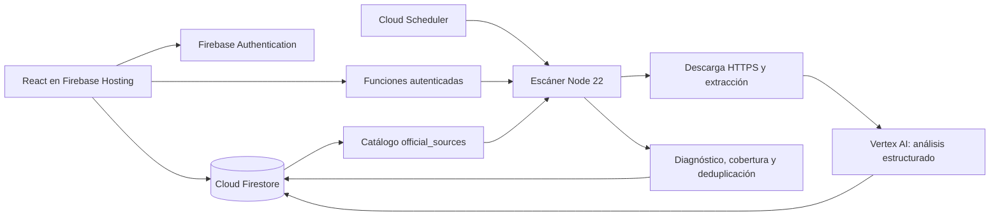

# Arquitectura vigente

Contratos actualizados por [ADR-0005](adr/0005-mvp-datos-reales-y-acceso.md). Los ADR originales conservan el contexto histórico; no prevalecen sobre las decisiones que los reemplazan parcialmente.

## Componentes

- Cliente: React 18, TypeScript, Vite y Tailwind. Las áreas Regulatorio/PI son filtros de trabajo, no RBAC.
- Backend: Cloud Functions 2nd Gen, Node 22, región `us-central1`. El escaneo diario usa `America/Bogota`.
- IA: `@google-cloud/vertexai`; modelo configurable en `functions/src/ai/config.ts` (`gemini-3.5-flash`, región `global` por defecto). La cuenta de servicio accede a Vertex AI mediante IAM. El SDK necesita actualización; véase DEBT-009.
- Catálogo: Firestore, sin fallback estático. La baja conserva el documento con `deletedAt` y excluye la fuente de nuevas ejecuciones.

## Datos y autorización

| Colección | Contrato del cliente autenticado |
| --- | --- |
| `regulatory_opportunities` | Lectura y gestión de oportunidades, asignaciones y notas. |
| `team_members` | Lectura y escritura de directorio. |
| `official_sources` | Solo lectura directa; cambios validados por `manageOfficialSource`. |
| `daily_digests` | Solo lectura; el backend genera reportes. |
| `scan_runs` | Solo lectura de cobertura y errores. |
| `processed_documents` | Solo lectura; el backend escribe deduplicación. |
| `scanner_state` | Sin acceso del cliente; lock exclusivo del backend. |

Las reglas y `requireSpiMember` exigen email verificado de `spiamericas.com` o `spohr.cl`. Los callables rechazan sesiones ausentes o no autorizadas; el reporte HTTP verifica el ID token. **App Check no está impuesto.** No hay aislamiento multicliente ni permisos por vertical: registrar roles más finos requiere otra decisión y pruebas.

## Ingesta y fallos parciales

Cada fuente se descarga con HTTPS validado, direcciones DNS públicas y conexión fijada a la dirección validada, incluyendo redirecciones. Se prefiere IPv4 y hay un reintento ante errores transitorios de conexión. No se omite la validación de certificados ni se resuelven CAPTCHAs automáticamente.

Los formatos soportados son RSS/Atom, HTML, listado JSON público de ANVISA y PDF con texto. Los enlaces PDF cortos usan el contexto de su fila. La muestra está limitada a 15 MB, 20 páginas y 30.000 caracteres por documento. No existe OCR.

Los documentos legibles se conservan aunque otros fallen. `health` distingue éxito, lectura parcial, feed vacío, bloqueo, indisponibilidad y formato no soportado; las comprobaciones de lectura no invocan Gemini. El escaneo incluye presupuestos de tiempo y puede dejar fuentes pendientes. La ejecución queda registrada como parcial cuando hay fallos o cobertura incompleta.

La identidad del documento deriva de su URL y fuente; `processed_documents` registra los análisis exitosos. La oportunidad usa un ID determinista y `create()` para conservar asignaciones al reintentar. Esto **no** detecta cambios de contenido en una URL ya procesada (DEBT-008).

## Contrato de IA y reporte

El analizador solicita JSON con esquema, valida clasificación con Zod y conserva solo citas contenidas en el texto de entrada. Los errores se propagan y dejan el documento disponible para reintento. La normalización no demuestra fidelidad semántica de resúmenes, fechas o interpretación: se requiere revisión profesional y evaluación adicional.

El digest destaca urgencias `critical` y `high`, conserva estadísticas y declara cobertura/error. Un reporte sin hallazgos prioritarios se limita a los documentos consultados. No equivale a una declaración de ausencia de obligaciones legales. No hay envío automático de correo. Las evaluaciones locales de contrato y sus límites se describen en el README y DEBT-006.
