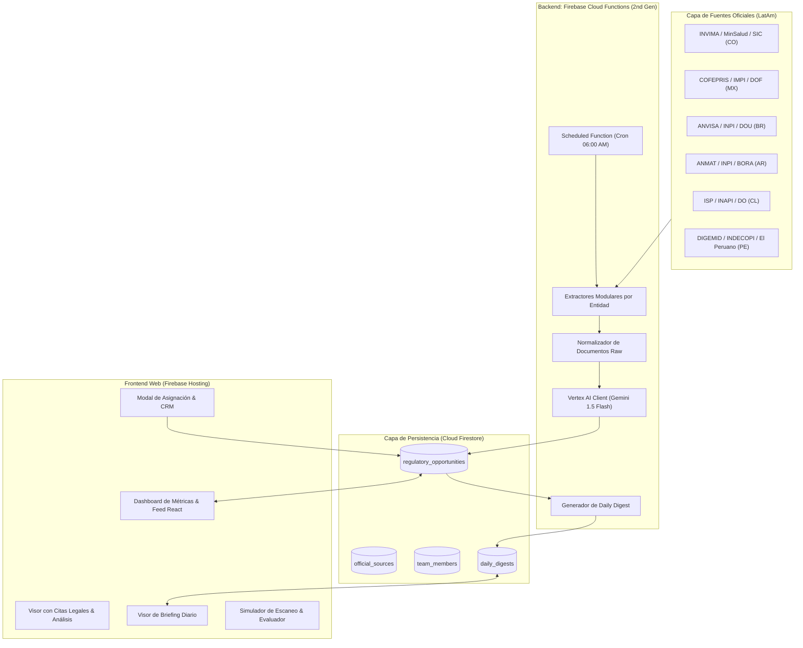

# Arquitectura del Sistema — SPI Regulatory Scanner

## 1. Visión General
El **SPI Regulatory Scanner & Opportunity Radar** es un sistema serverless distribuido desplegado sobre la plataforma **Firebase** y respaldado por la infraestructura de **Google Cloud Vertex AI**. Su objetivo es transformar actos normativos, resoluciones y boletines emitidos por entidades oficiales de América Latina en acciones de negocio estructuradas para el equipo de **SPI Américas**.



---

## 2. Componentes del Sistema

### 2.1 Ingesta y Extracción (`functions/src/sources/`)
- **Registro Central de Fuentes (`registry.ts`):** Catálogo tipado que define metadatos por entidad: país, categoría (`sanitary`, `intellectual_property`, `official_gazette`), sectores cubiertos, URLs de feeds/portales y periodicidad de escaneo.
- **Normalizador de Documentos Raw:** Convierte formatos dispares (HTML, RSS, XML, texto plano) a la estructura unificada `RawRegulatoryDocument`.

### 2.2 Pipeline de Inteligencia (`functions/src/ai/`)
- **Motor Vertex AI Gemini (`geminiAnalyzer.ts`):** 
  - Utiliza el modelo `gemini-1.5-flash-002` con temperatura baja (`0.1`) para garantizar máxima fidelidad legal y mínima alucinación.
  - Implementa un `responseSchema` estricto de JSON.
  - El system prompt encarna el rol de *Director Senior de Asuntos Regulatorios y PI de SPI Américas*, obligando a descartar actos administrativos de rutina y evaluar impacto comercial directo.
- **Generador de Digest Diario (`dailyDigest.ts`):**
  - Aplica filtro de urgencia estricto (`critical` y `high`).
  - Genera un briefing ejecutivo sintético para la dirección de SPI.
  - Si no hay novedades de alto impacto, genera el estado especial de "Sin novedades críticas", sin saturar con falsos positivos.

### 2.3 Persistencia y Modelo de Datos (`Cloud Firestore`)

#### Colección `regulatory_opportunities`
Documentos que representan un hallazgo analizado y enriquecido por la IA:
```typescript
{
  id: string;                      // opp-co-invima-agil-2026
  documentId: string;              // Identificador de la norma
  title: string;                   // Título sintetizado
  country: 'CO' | 'MX' | 'BR' | 'AR' | 'CL' | 'PE';
  entityName: string;              // INVIMA, COFEPRIS, ANVISA...
  sectors: RegulatorySector[];     // farma, medical_devices, etc.
  sourceUrl: string;               // URL a la norma oficial
  publicationDate: string;         // YYYY-MM-DD
  documentNumber?: string;         // Resolución 014-2026, etc.
  isRelevant: boolean;
  opportunityType: 'commercial_opportunity' | 'mandatory_compliance';
  urgency: 'critical' | 'high' | 'medium' | 'low';
  executiveSummary: string;
  detailedAnalysis: string;
  effectiveDate?: string;
  transitionalDeadline?: string;
  daysRemainingForAction?: number;
  spiActionPlan: {
    whatClientsNeedToDo: string;
    howSpiCanHelp: string;
    affectedClientProfile: string;
    recommendedServiceOffering?: string;
  };
  citations: Array<{
    articleOrSection: string;
    quoteText: string;
    interpretation: string;
  }>;
  status: 'nueva' | 'en_evaluacion' | 'asignada' | 'contactando_clientes' | 'cerrada';
  assignedTo?: { id: string; name: string; email: string; role: string; };
  assignedAt?: string;
  managementNotes?: Array<{ author: string; date: string; comment: string; }>;
}
```

---

## 3. Seguridad y Control de Acceso

- **Reglas de Seguridad Firestore (`firestore.rules`):**
  - Control de lectura/escritura por colección.
  - Preparado para restringir mutaciones de asignaciones exclusivamente a usuarios autenticados con dominio `@spiamericas.com`.
- **Ejecución de Cloud Functions:**
  - Invocación de scrapers protegida mediante Cloud Scheduler (roles de servicio IAM `roles/cloudscheduler.serviceAgent`).
  - Endpoints de mutación de tareas (`assignOpportunityToMember`) protegidos con Firebase App Check y verificación de token en producción.
